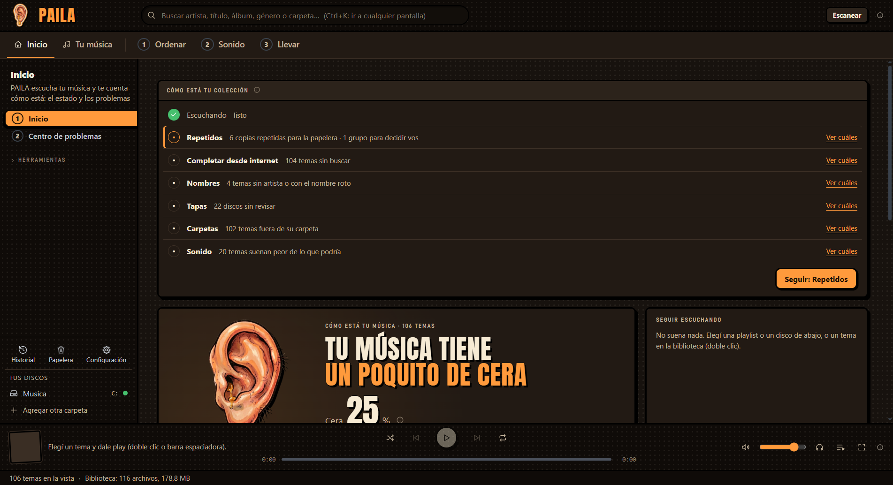
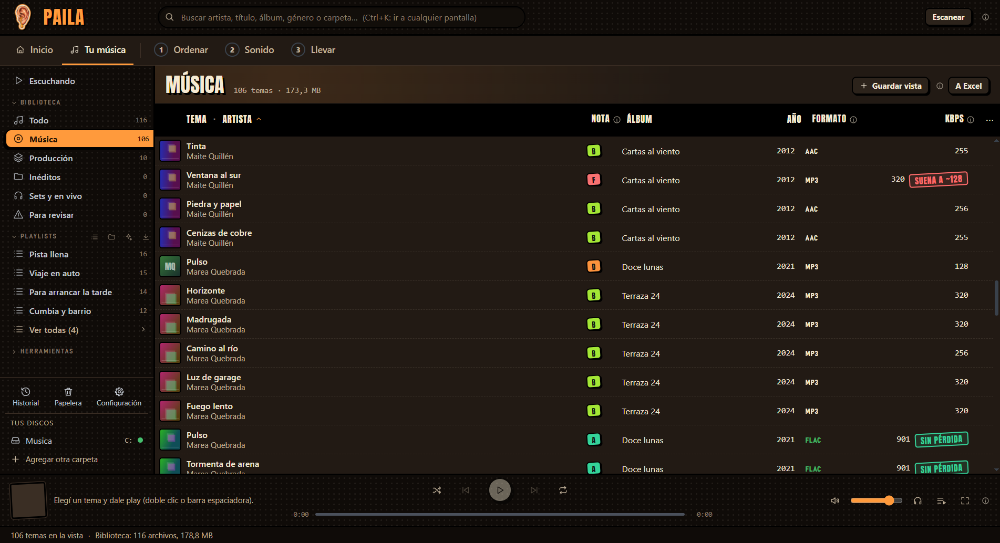
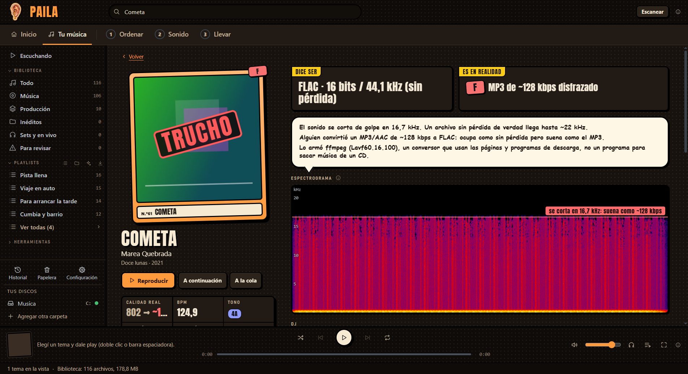
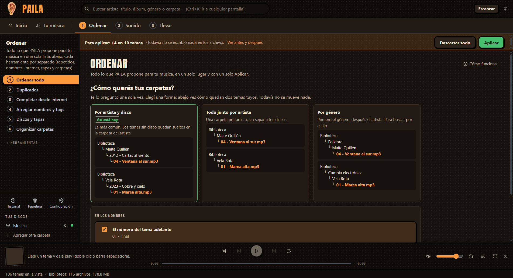
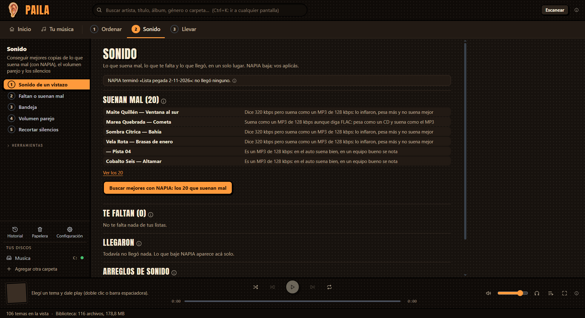
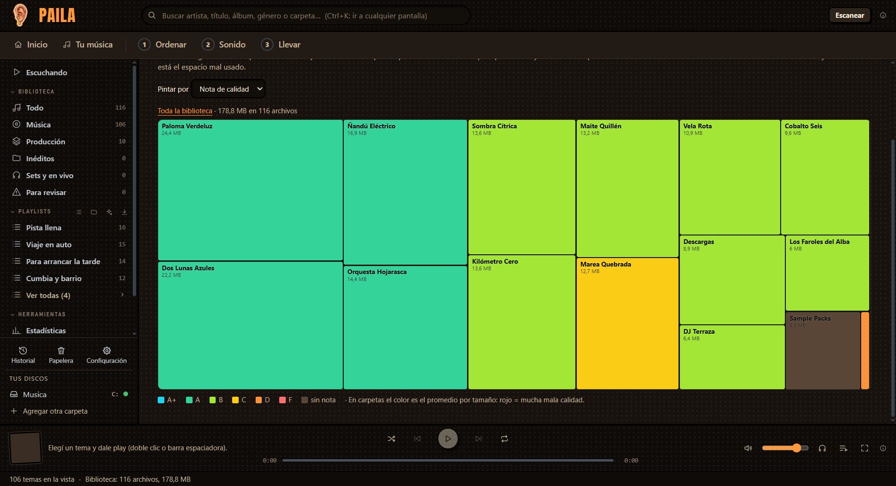

# PAILA

*[English](README.md) · Castellano*

**Ver, ordenar, mejorar y hacer lugar en tu biblioteca de música.** Para cualquiera que tenga mucha música acumulada: discos enteros, descargas de años, pendrives viejos, carpetas que nadie ordenó nunca. Las funciones para DJs y productores (BPM, tono, grillas, Rekordbox) están, pero son una parte, no el centro. Libre y de código abierto (AGPL-3.0). Habla castellano e inglés.

<!-- capturas -->


## Qué hace

PAILA se ordena en pestañas que van de izquierda a derecha, en el orden que conviene:

| | |
|---|---|
| **Inicio** | Cómo está tu colección de un vistazo: repetidos, nombres, carpetas, tapas y sonido, con un botón para seguir, así siempre sabés qué toca. |
| **Tu música** | Una tabla rápida con búsqueda, la **calidad de verdad** de cada tema (una nota de A+ a F con su explicación: "dice ser un MP3 de 320, en realidad suena como uno de 128"), la ficha de cada tema con su espectrograma, un reproductor y tus playlists (comunes, carpetas e inteligentes; traer una lista de Spotify u otro lado y ver qué tenés). |
| **Ordenar** | Una sola revisión: los repetidos idénticos a la papelera, nombres prolijos, nombres y tapas desde internet (MusicBrainz y otras fuentes) y carpetas que se arman con bloques (por disco, por artista o por género), todo junto y con un solo **Aplicar**. Lo dudoso lo decidís ahí mismo. |
| **Sonido** | Lo que suena mal o te falta, en un solo lugar: cambiar un tema por una copia mejor (con escucha A/B), una bandeja que revisa lo que llega, volumen parejo y recortar silencios largos. |
| **Llevar** | Al celular (en AAC o MP3, ocupa menos), al auto o a un pendrive, y a otros programas de música. |
| **DJ y producción** | BPM, tono (Camelot), energía y grilla; exportar a pendrive para CDJ, a Rekordbox, Traktor, Serato, VirtualDJ y Engine DJ; orden armónico, armar un set y separar la voz. Se prende con un interruptor y, si no lo usás, no estorba. |

Además: duplicados por nombre y por cómo suenan, un mapa de qué ocupa tu disco, WAV → FLAC sin perder nada (verificado), la música guardada en ZIP y RAR, y pasar PAILA entera a otra compu.

**PAILA no rompe nada.** Nada se borra de verdad (tiene su propia papelera). Todo cambio en tus archivos pasa antes por una vista previa ("Cambios pendientes") y se puede deshacer desde el Historial. Los sample packs nunca se renombran ni se mueven. **PAILA no descarga música.**

<!-- más capturas -->
| | |
|---|---|
|  |  |
|  |  |
|  | |

*Las capturas son de una biblioteca de demo con artistas y temas inventados.*

## Bajarla

- **Windows 10 u 11** (64 bits): el instalador o la versión portable, en [Releases](https://github.com/epitelio-ar/PAILA/releases). La descarga pesa unos 320 MB y el programa instalado ocupa cerca de 1 GB (trae su propio ffmpeg, un reproductor y el modelo de la grilla). Anda sin internet; internet hace falta solo para lo que lo usa.
- **Mac**: en prueba, todavía sin versión para bajar.
- El primer análisis (calidad, BPM y tono) corre de a poco mientras usás la app: con una biblioteca grande puede llevar horas, pero no frena nada.
- PAILA avisa cuando hay una versión nueva y la instala solo si se lo pedís (se puede apagar en Configuración → Actualizaciones). La portable no se reemplaza sola: abre la página para bajarla.

### "Windows protegió su PC"

La 1.0, la primera versión pública, sale **sin firma digital** (la pedimos cuando esté afuera: ver [Firma](#firma-de-los-instaladores)). Por eso Windows puede avisar las primeras veces:

1. **SmartScreen** muestra "Windows protegió su PC" y "Editor desconocido": tocá **Más información** → **Ejecutar de todos modos**.
2. Algunos navegadores dicen que el archivo "no se descarga habitualmente": elegí **Conservar** (en Edge, en los tres puntitos).

## Privacidad

- **PAILA no manda tus datos a nadie.** No hay cuentas, ni estadísticas de uso, ni nada que "llame a casa".
- Sale a internet solo para lo que lo necesita y cuando lo usás: completar nombres, tapas y géneros (manda artista, título, duración o la huella acústica del tema; nunca rutas ni nombres de carpetas), y la consulta de versiones nuevas a GitHub al abrir (se apaga en Configuración).
- Las claves de servicios que pegues (Discogs, Last.fm, AudD…) se guardan cifradas en tu compu.
- **Exportar diagnóstico** (Configuración → Si algo anda mal) arma un zip para mandar **solo si querés**, cuando reportás un error. Antes de guardarlo te muestra todo lo que lleva: versión, sistema, cantidades y errores, con las rutas y los nombres tapados. No lleva tu música, ni nombres de temas, carpetas o playlists.

## NAPIA y Soulseek

**NAPIA** es la hermana de PAILA: un panel aparte para usar [sockseek](https://github.com/fiso64/sockseek), un programa libre que busca y baja de la red **Soulseek**, sin escribir comandos. Le das una lista (por ejemplo, lo que PAILA anotó en la lista «Faltan o suenan mal»), elegís la calidad, y NAPIA le arma el pedido a sockseek y muestra cómo va. Viene en la misma descarga que PAILA, pero es **opcional**: es una casilla del instalador que podés destildar (o sumar después, reinstalando). PAILA no la necesita para nada.

- **Para qué sirve:** conseguir una copia mejor de la música que ya tenés, o los temas que faltan de tus propias listas. Soulseek es una red entre personas que existe desde 2002, donde muchos comparten su propia música, ediciones agotadas y grabaciones que no están en ninguna tienda. NAPIA no trae música ni listas de nadie: solo busca lo que le pedís.
- La cuenta de Soulseek es tuya y queda en la configuración de sockseek; NAPIA no la pide ni la guarda.
- NAPIA usa una versión de sockseek con un freno de conexiones para que no se trabe el router de tu casa (el cambio y su código están en [`apps/napia/sockseek-freno/`](apps/napia/sockseek-freno/)).
- **Lo que se baja de Soulseek es responsabilidad de quien lo baja.** Soulseek es una red entre personas: PAILA y NAPIA no alojan, no ofrecen ni eligen ningún archivo. Respetá los derechos de autor y las leyes de tu país.

## Firma de los instaladores

*Política de firma (code signing policy).*

- Los instaladores de Windows se arman **solo** en GitHub Actions, desde el código de este repositorio ([`.github/workflows/version.yml`](.github/workflows/version.yml)); nunca en la compu de nadie.
- Cuando el proyecto tenga firma: *Free code signing provided by [SignPath.io](https://about.signpath.io), certificate by [SignPath Foundation](https://signpath.org)*. Se firman solo los programas propios (`PAILA.exe`, el instalador y la portable), nunca los de terceros que viajan adentro (ffmpeg, ffprobe, mpv, sockseek).
- **Quién hace qué:**
  - Autor y quien revisa los cambios: [Bllly Shears](https://github.com/epitelio-ar).
  - Quien aprueba cada versión firmada: [Bllly Shears](https://github.com/epitelio-ar), con la verificación en dos pasos de GitHub prendida.
- **Privacidad:** PAILA no manda información a otros sistemas, salvo cuando quien la usa lo pide (completar desde internet, tapas, géneros, NAPIA) y la consulta de versiones nuevas al abrir, que se puede apagar. Ver [Privacidad](#privacidad).

## Si algo anda mal

- **Un error o una idea:** abrí un [issue](https://github.com/epitelio-ar/PAILA/issues/new/choose) con la plantilla que corresponda. Si es un error, contá qué hiciste, qué esperabas y qué pasó; si podés, sumá el zip de **Exportar diagnóstico**.
- **Un problema de seguridad:** no lo pongas en un issue público; seguí [SECURITY.md](SECURITY.md).

## Para programar

Requisitos: Node.js 22.12 o más nuevo y Windows (la Mac está en prueba).

```bash
npm install
npx install-electron   # baja el programa de Electron
npm run ffprobe:bajar  # en Windows: el ffprobe que viaja con PAILA (revisado por huella; algunos tests lo necesitan)
npm run dev            # abre PAILA con recarga en vivo
npm run check          # tipos y tests
```

La guía completa (cómo está armado, reglas del producto, estilo, idiomas, cómo probar sin romper la música de nadie) está en [AGENTS.es.md](AGENTS.es.md), y sirve tanto para personas como para agentes de código. Cómo sumar cambios: [CONTRIBUTING.md](CONTRIBUTING.md). Mapa del código, una línea por archivo: [docs/MAPA.md](docs/MAPA.md). Qué cambió en cada versión: [docs/NOVEDADES.md](docs/NOVEDADES.md).

## Licencia

PAILA y NAPIA son software libre bajo la [GNU Affero General Public License v3.0 o posterior](LICENSE) (AGPL-3.0-or-later). Podés usarlas, estudiarlas, cambiarlas y compartirlas; si repartís una versión cambiada (también como servicio en red), tenés que compartir su código con la misma licencia. Lo que viaja con la app de terceros y sus licencias: [docs/licencias.md](docs/licencias.md).

© 2026 Bllly Shears.
