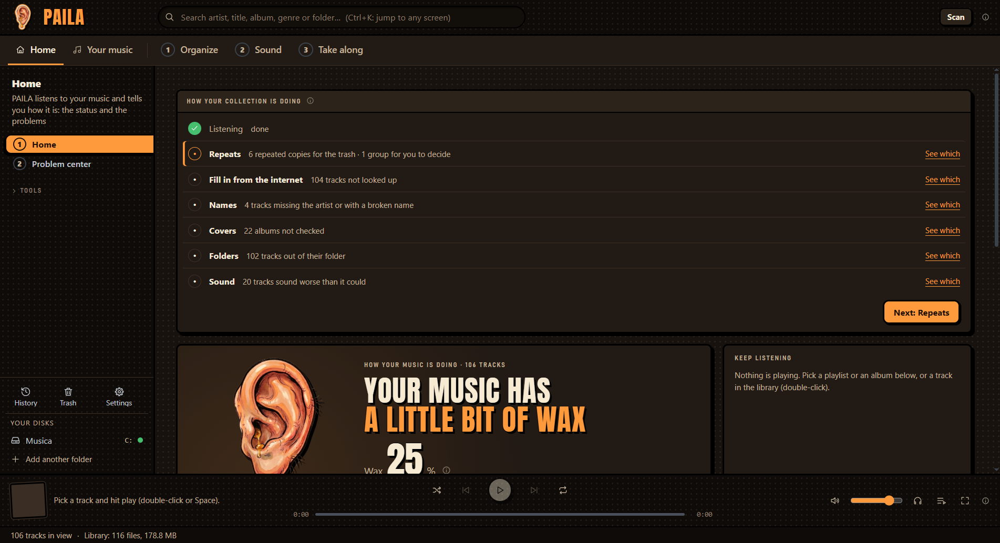
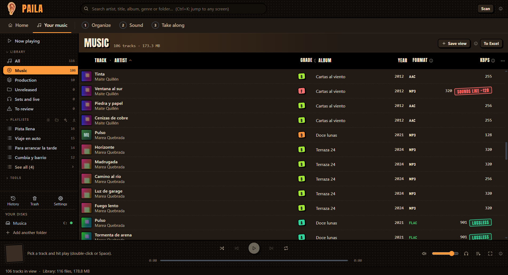
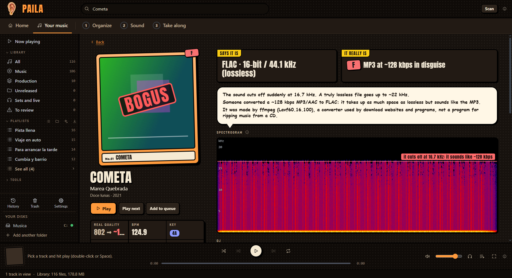
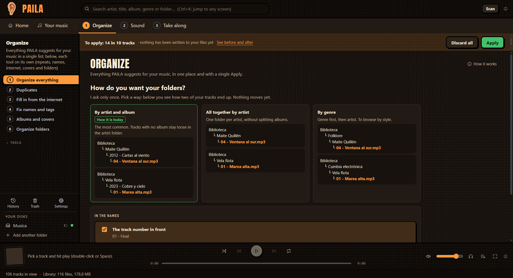
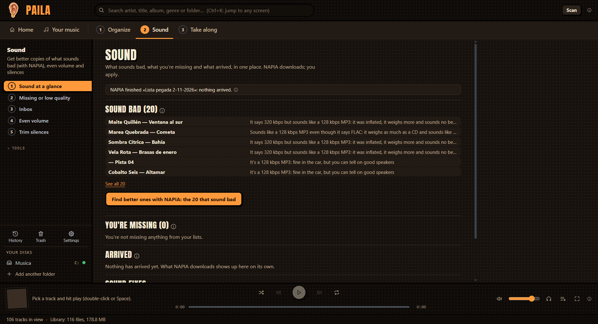
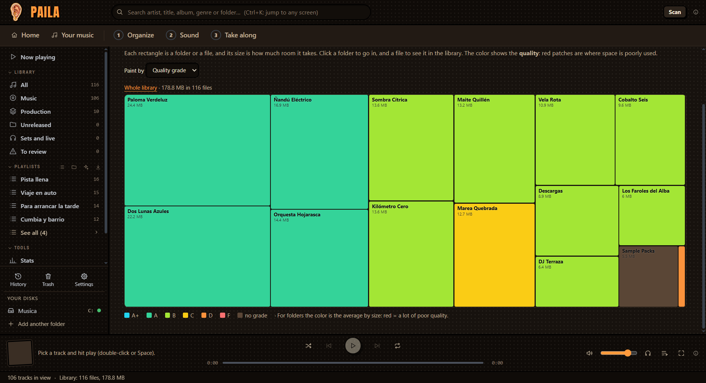

# PAILA

*English · [Castellano](README.es.md)*

**See, tidy up, improve and free up space in your music library.** For anyone with a lot of music piled up: whole albums, years of downloads, old USB sticks, folders nobody ever sorted. The features for DJs and producers (BPM, key, beat grids, Rekordbox) are there, but they're one part, not the center. Free and open source (AGPL-3.0). It speaks English and Spanish.

<!-- screenshots -->


## What it does

PAILA is organized in tabs that go from left to right, in the order that makes sense:

| | |
|---|---|
| **Home** | How your collection is doing at a glance: repeats, names, folders, covers and sound, with a button for the next step, so you always know where to go. |
| **Your music** | A fast table with search, every track's **real quality** (a grade from A+ to F with its explanation: "claims to be a 320 MP3, actually sounds like a 128 one"), track details with a spectrogram, a player and your playlists (regular, folders and smart ones; bring in a list from Spotify or elsewhere and see what you already have). |
| **Organize** | One single review: identical repeats to the trash, tidy names, names and covers from the internet (MusicBrainz and other sources) and folders built with blocks (by album, by artist or by genre), shown together with one **Apply**. What's doubtful you decide right there. |
| **Sound** | What sounds bad or is missing, in one place: swap a track for a better copy (with A/B listening), an Inbox that checks what comes in, even volume and trimming long silences. |
| **Take along** | To your phone (AAC or MP3, takes less space), the car or a USB stick, and to other music programs. |
| **DJ and production** | BPM, key (Camelot), energy and beat grid; export to a USB stick for CDJs, to Rekordbox, Traktor, Serato, VirtualDJ and Engine DJ; harmonic ordering, set building and vocal separation. It's behind one switch and stays out of the way if you don't use it. |

Also: duplicates by name and by how they sound, a map of what takes up your disk, lossless WAV → FLAC (verified), music saved in ZIP and RAR, and moving PAILA to another computer.

**PAILA doesn't break anything.** Nothing is really deleted (it has its own trash). Every change to your files goes through a preview first ("Pending changes") and can be undone from the History. Sample packs are never renamed or moved. **PAILA doesn't download music.**

<!-- more screenshots -->
| | |
|---|---|
|  |  |
|  |  |
|  | |

*Screenshots use a demo library with made-up artists and tracks.*

## Download

- **Windows 10 or 11** (64-bit): the installer or the portable version, in [Releases](https://github.com/epitelio-ar/PAILA/releases). The download is about 320 MB and the installed program takes about 1 GB (it brings its own ffmpeg, a player and the beat-grid model). It works offline; the internet is only for the features that need it.
- **Mac** (macOS 12 or newer): the `.dmg` in [Releases](https://github.com/epitelio-ar/PAILA/releases/latest): `PAILA-mac-arm64-…` for Apple M1 to M4, `PAILA-mac-x64-…` for Intel. Open it and drag PAILA to Applications. It doesn't update itself yet: PAILA lets you know and opens the download page.
- The first analysis (quality, BPM and key) runs little by little while you use the app: with a big library it can take hours, but it doesn't block anything.
- PAILA lets you know when there's a new version and only installs it if you ask (you can turn this off in Settings → Updates). The portable version doesn't replace itself: it opens the download page.

### "Windows protected your PC"

Version 1.0, the first public one, ships **without a digital signature** (we'll apply for one again once the project is better known: see [Code signing policy](#code-signing-policy)). That's why Windows may warn you the first times:

1. **SmartScreen** shows "Windows protected your PC" and "Unknown publisher": click **More info** → **Run anyway**.
2. Some browsers say the file "isn't commonly downloaded": choose **Keep** (in Edge, under the three dots).

### "Apple could not verify PAILA" (Mac)

The Mac version isn't notarized by Apple (that needs a paid developer account), so the first time macOS won't open it:

1. Click **Done** (not "Move to Trash").
2. Open **System Settings** → **Privacy & Security**, scroll down to the message that says PAILA was blocked and click **Open Anyway**. Enter your password.
3. From then on it opens normally.

## Privacy

- **PAILA doesn't send your data to anyone.** No accounts, no usage statistics, nothing that "phones home".
- It only goes online for the features that need it, when you use them: filling in names, covers and genres (it sends artist, title, duration or the track's acoustic fingerprint; never paths or folder names), and checking GitHub for new versions on startup (can be turned off in Settings).
- Service keys you paste in (Discogs, Last.fm, AudD…) are stored encrypted on your computer.
- **Export diagnostic** (Settings → If something goes wrong) builds a zip you send **only if you want to**, when reporting a bug. Before saving it, it shows you everything inside: version, system, counts and errors, with paths and names hidden. It doesn't include your music, or the names of tracks, folders or playlists.

## NAPIA and Soulseek

**NAPIA** is PAILA's sibling: a separate panel for using [sockseek](https://github.com/fiso64/sockseek), a free program that searches and downloads from the **Soulseek** network, without typing commands. You give it a list (for example, what PAILA noted down in the "Missing or low quality" list), choose the quality, and NAPIA builds the request for sockseek and shows how it's going. It comes in the same download as PAILA, but it's **optional**: a checkbox in the installer that you can untick (or add later by reinstalling). PAILA doesn't need it for anything.

- **What it's for:** finding a better copy of music you already have, or the tracks missing from your own lists. Soulseek is a network between people that has existed since 2002, where many share their own music, out-of-print releases and recordings that aren't in any store. NAPIA brings no music and no lists from anyone: it only searches what you ask for.
- The Soulseek account is yours and stays in sockseek's settings; NAPIA neither asks for it nor stores it.
- NAPIA uses a version of sockseek with a connection brake so your home router doesn't freeze (the change and its code are in [`apps/napia/sockseek-freno/`](apps/napia/sockseek-freno/)).
- **Whatever is downloaded from Soulseek is the responsibility of whoever downloads it.** Soulseek is a network between people: PAILA and NAPIA don't host, offer or choose any file. Respect copyright and the laws of your country.

## Code signing policy

- Windows installers are built **only** on GitHub Actions, from this repository's code ([`.github/workflows/version.yml`](.github/workflows/version.yml)); never on anyone's computer.
- Once the project is signed: *Free code signing provided by [SignPath.io](https://about.signpath.io), certificate by [SignPath Foundation](https://signpath.org)*. Only the project's own programs are signed (`PAILA.exe`, the installer and the portable version), never the third-party ones bundled inside (ffmpeg, ffprobe, mpv, sockseek).
- **Who does what:**
  - Author, committer and reviewer: [Bllly Shears](https://github.com/epitelio-ar).
  - Approver of every signed release: [Bllly Shears](https://github.com/epitelio-ar), with GitHub two-factor authentication turned on.
- **Privacy:** PAILA doesn't transfer information to other networked systems, except when the person using it asks for it (filling in from the internet, covers, genres, NAPIA) and the new-version check on startup, which can be turned off. See [Privacy](#privacy).

## If something goes wrong

- **A bug or an idea:** open an [issue](https://github.com/epitelio-ar/PAILA/issues/new/choose) with the matching template. For a bug, say what you did, what you expected and what happened; if you can, attach the **Export diagnostic** zip.
- **A security problem:** don't post it in a public issue; follow [SECURITY.md](SECURITY.md).

## Development

Requirements: Node.js 22.12 or newer and Windows (Mac is being tested).

```bash
npm install
npx install-electron   # downloads the Electron binary
npm run ffprobe:bajar  # on Windows: the ffprobe that ships with PAILA (checked by hash; some tests need it)
npm run dev            # opens PAILA with live reload
npm run check          # types and tests
```

The full guide (how it's built, product rules, style, languages, how to test without breaking anyone's music) is in [AGENTS.md](AGENTS.md), for people and coding agents alike. How to contribute: [CONTRIBUTING.md](CONTRIBUTING.md). Code map, one line per file: [docs/MAPA.md](docs/MAPA.md) (in Spanish). What changed in each version: [docs/NOVEDADES.en.md](docs/NOVEDADES.en.md).

## License

PAILA and NAPIA are free software under the [GNU Affero General Public License v3.0 or later](LICENSE) (AGPL-3.0-or-later). You can use, study, change and share them; if you distribute a modified version (including as a network service), you must share its code under the same license. Third-party components bundled with the app and their licenses: [docs/licencias.md](docs/licencias.md).

© 2026 Bllly Shears.
